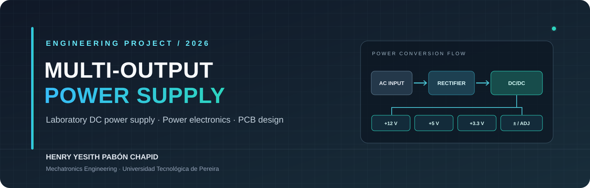

<!--
  Project: Multi-Output Power Supply
  Author: Henry Yesith Pabón Chapid
  Universidad Tecnológica de Pereira · Ingeniería Mecatrónica
-->

<div align="center">

  

  <p>
    <strong>Diseño y desarrollo de una fuente de alimentación DC multisalida para laboratorio.</strong>
    <br>
    Electrónica de potencia · Conversión DC/DC · Diseño de PCB · Validación
  </p>

  <p>
    <a href="#-visión-general">Visión general</a> ·
    <a href="#-especificaciones-del-sistema">Especificaciones</a> ·
    <a href="#-arquitectura">Arquitectura</a> ·
    <a href="#-documentación">Documentación</a> ·
    <a href="#-desarrollo">Desarrollo</a>
  </p>

  <p>
    
    
    
    
  </p>
</div>

---

## ⚡ Visión general

**Multi-Output Power Supply** es un proyecto académico de diseño electrónico orientado al desarrollo de una fuente de alimentación DC para laboratorio. El sistema contempla una etapa de entrada mediante transformador AC, rectificación con puente de diodos, filtrado capacitivo y regulación mediante convertidores DC/DC integrados en una PCB.

El objetivo es disponer de diferentes niveles de tensión para alimentar circuitos y prototipos electrónicos, manteniendo una arquitectura modular que facilite el análisis, la implementación y la validación de cada etapa.

> **Alcance:** este repositorio reúne la documentación técnica, diagramas, selección de componentes, cálculos y archivos de diseño asociados al desarrollo. Los valores indicados corresponden a las especificaciones del proyecto; no deben interpretarse como resultados de pruebas ya validadas.

## 👤 Autor

**Henry Yesith Pabón Chapid**  
Estudiante de Ingeniería Mecatrónica  
Universidad Tecnológica de Pereira · Facultad de Tecnología  
Pereira, Colombia · 2026

Este repositorio forma parte de mi trabajo de diseño y prototipado electrónico, con énfasis en electrónica de potencia, selección de componentes y diseño de PCB.

## 🔌 Especificaciones del sistema

El proyecto contempla cinco salidas DC:

| Salida | Rango / tensión nominal | Corriente máxima |
|:--|:--:|--:|
| Positiva 1 | +12 V DC | 5 A |
| Positiva 2 | +5 V DC | 5 A |
| Positiva 3 | +3.3 V DC | 3 A |
| Negativa | −12 V DC | 1 A |
| Ajustable | 1.25–15 V DC | 3 A |

Las corrientes son los límites máximos especificados para cada salida. La capacidad de operación simultánea y la potencia total disponible deberán verificarse mediante el dimensionamiento del sistema y las pruebas correspondientes.

## 🧩 Arquitectura

La arquitectura funcional definida para el proyecto sigue esta secuencia:

<div align="center">
  
  
  
  
  
</div>

```text
Transformador AC
      │
      ▼
Puente rectificador
      │
      ▼
Filtro capacitivo
      │
      ▼
Bus DC
      │
      ├── Conversión DC/DC ── +12 V / 5 A
      ├── Conversión DC/DC ── +5 V / 5 A
      ├── Conversión DC/DC ── +3.3 V / 3 A
      ├── Conversión DC/DC ── −12 V / 1 A
      └── Conversión DC/DC ── 1.25–15 V / 3 A
```

La implementación de cada rama, sus componentes y sus condiciones de operación se documentarán conforme avance el diseño. Consulta el diagrama de distribución de potencia disponible en la sección de documentación.

## 🛠️ Herramientas de desarrollo

| Herramienta | Aplicación |
|:--|:--|
| **Altium Designer** | Captura esquemática, bibliotecas y diseño de PCB |
| **diagrams.net** | Diagramas de bloques y arquitectura eléctrica |
| **Saturn PCB Toolkit** | Estimaciones de pistas, corriente, caída de tensión y vías |
| **DigiKey / LCSC** | Consulta y verificación de componentes comerciales |
| **Datasheets oficiales** | Verificación de límites y características eléctricas |

## 📁 Documentación

| Recurso | Descripción |
|:--|:--|
| [Electrical power tree](Documentaci%C3%B3n/Electrical%20power%20tree.drawio) | Diagrama de distribución y ramas de potencia |
| [Documentación del proyecto](Documentaci%C3%B3n/) | Archivos técnicos disponibles en el repositorio |
| Datasheets de componentes | Se incorporarán con sus MPN exactos, revisión y enlace oficial del fabricante una vez verificados y organizados en el repositorio |

Los enlaces a hojas de datos y componentes comerciales deben apuntar a documentos oficiales y referencias exactas. La documentación se ampliará a medida que se consoliden las selecciones y revisiones.

## 🧪 Desarrollo

El trabajo se organiza en las siguientes etapas:

- [ ] Consolidación y trazabilidad de requerimientos.
- [ ] Definición y revisión de la arquitectura eléctrica.
- [ ] Dimensionamiento de rectificación y filtrado.
- [ ] Selección y verificación de convertidores y componentes de potencia.
- [ ] Desarrollo y revisión de esquemáticos.
- [ ] Diseño de PCB y revisión de reglas eléctricas.
- [ ] Fabricación y ensamblaje del prototipo.
- [ ] Validación eléctrica, térmica y funcional.
- [ ] Documentación de resultados y mejoras.

El estado de cada actividad se actualizará con evidencia técnica; no se marcará como completada únicamente por disponer de un archivo de diseño.

## 📐 Criterios de ingeniería

Durante el desarrollo se prestará especial atención a:

- Márgenes de tensión y corriente de los componentes.
- Pérdidas de conversión y eficiencia por rama.
- Rizado, respuesta transitoria y regulación.
- Disipación térmica y temperatura de operación.
- Ancho de pistas, caída de tensión y distribución de retornos.
- Protección frente a cortocircuito, sobrecorriente y sobretemperatura.
- Accesibilidad para medición, inspección y mantenimiento.

Los valores finales, tolerancias y criterios de aceptación se documentarán con su fuente y método de verificación.

## 📌 Estado del proyecto

**En desarrollo.** Este repositorio se actualizará progresivamente con los cálculos, esquemáticos, archivos de PCB, documentación de componentes y resultados de validación.

---

<div align="center">

  **Diseñado y documentado por Henry Yesith Pabón Chapid**

  *Power electronics · Embedded hardware · PCB design*

  <sub>Universidad Tecnológica de Pereira · 2026</sub>

</div>
